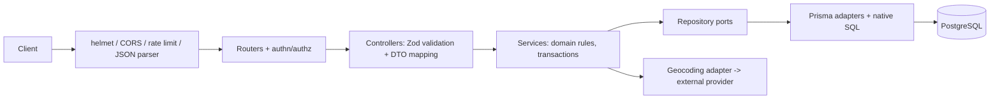
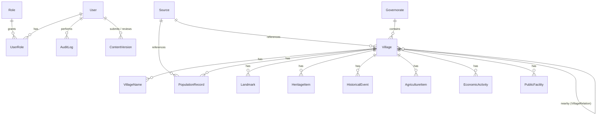

# Architecture

Layered modular monolith with dependency injection at the edges.

* **Controllers** only parse/validate input and map output. **Services** hold business rules and receive their repositories (and a `transaction` function) through the constructor, so they are unit-testable with in-memory mocks (`tests/mocks`).
* **Composition roots**: `src/app.js` (HTTP stack, auth) and `src/modules/villages/village.module.js` (village domain wiring).
* **Adapters**: `prisma-village-module.repositories.js` implements the repository ports; village listing uses native SQL (`$queryRaw`) for the "latest verified population" join, filtering, sorting and pagination.
* **Cross-cutting**: problem+json error model (`src/middleware/error.middleware.js`), BigInt-safe JSON, rate limiting, helmet, CORS allow-list.

## ERD (core)

